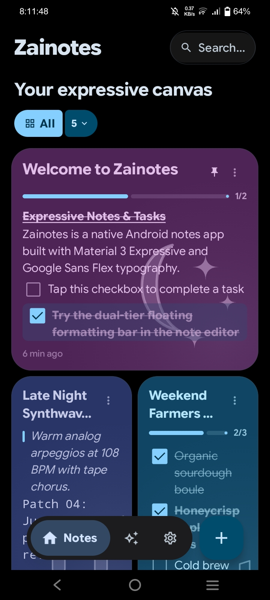
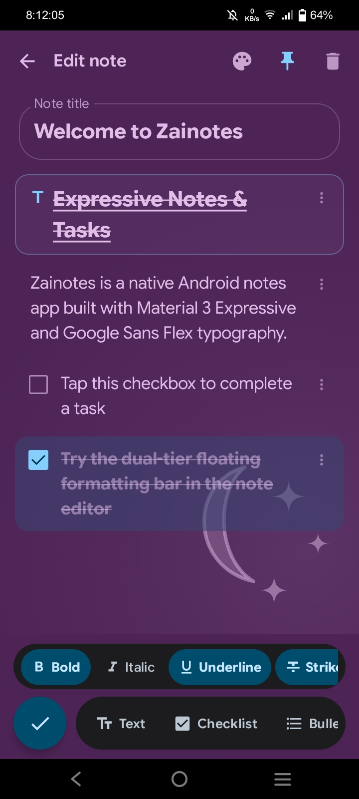
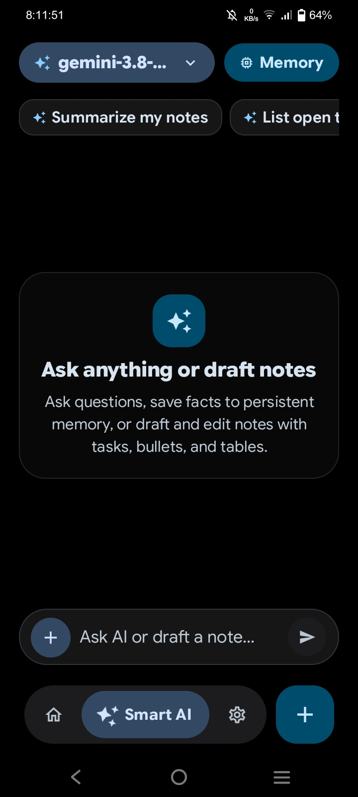
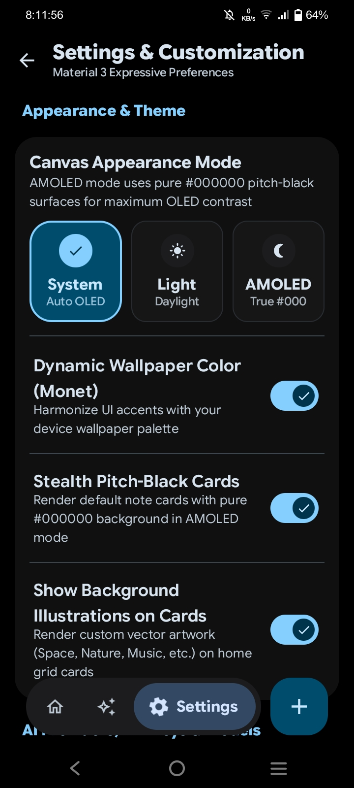

# ✨ Zainotes

> A modern, expressive, and privacy-focused Android notes, tasks, and AI workspace built with Jetpack Compose and Material 3 Expressive.

[](https://www.gnu.org/licenses/agpl-3.0)
[](https://www.android.com/)
[](https://developer.android.com/jetpack/compose)
[](https://m3.material.io/blog/building-with-m3-expressive)
[](https://github.com/hydroxideOH-OMG/Zainotes/releases/latest)
[](https://github.com/hydroxideOH-OMG/Zainotes/actions)

---

## 🌟 Highlights

- 🎨 **Material 3 Expressive System**: Vibrant color palettes, dynamic Monet theming, organic rounded corners, Google Sans Flex typography, spring physics, and fluid interactive components.
- 🖤 **Pure AMOLED Black**: True `#000000` pitch black mode across the canvas, cards, floating bottom navigation, editor actions, and dialog sheets for maximum OLED battery savings and contrast.
- 🤖 **Native AI Assistant & Tools**: Dedicated AI workspace with multi-provider connectivity, customizable endpoints, persistent chat sessions, memory management, and contextual note generation.
- ✂️ **Interactive Free-Form Sizing**: Crop-style visual card resizer with 4-corner draggable handles and rule-of-thirds composition guides to shape notes your way.
- 🖼️ **15 Vector Background Themes**: Beautifully bounded native vector illustrations including Groceries, Food & Cooking, Music, Recipes, Notes, Places, Cinema, Celebration, Storm, Dusk, Flora, Doodles, Ruled Lines, Graph Grid, and Dot Matrix.
- 📝 **Hybrid Block Architecture**:
  - **Rich Text Formatting**: Seamless inline bold, italic, underline, and strikethrough styling.
  - **Smart 1 2 3 Numbered Lists**: Automatically clusters consecutive items starting from `1.` and resets cleanly when interrupted.
  - **Interactive Checklists**: Check off tasks right from the note card on your home screen or within the editor.
  - **Code Blocks & Quotes**: Callouts and monospace syntax containers for developers and technical notes.
  - **Bulletins & Headings**: Fluid hierarchical structuring without markdown noise.
- 💊 **Ergonomic Floating Docks**: Dual-tier formatting bar and bottom pill docks crafted specifically for natural, single-handed thumbs-first reachability.
- ⚡ **R8 Code & Resource Shrinking**: Hardened minification and optimization producing a compact, fast-launching APK.
- 🔒 **100% Private & Offline-First**: Powered by Android Room (SQLite). Zero ads, zero background trackers, and completely operational offline.
- 💾 **JSON Backup & Restore**: One-tap full database export and import to preserve your data across devices.
- ⚖️ **Free & Open Source**: Licensed under the GNU Affero General Public License v3.0 (AGPLv3).

---

## 📱 Screenshots

| Expressive Home Canvas | Dual-Tier Note Editor |
| :---: | :---: |
|  |  |

| Smart AI Assistant | Settings & Appearance |
| :---: | :---: |
|  |  |

---

## 🛠️ Tech Stack & Architecture

- **Language:** Kotlin 2.0.21
- **UI Framework:** Jetpack Compose + Compose Material 3 1.3.1 (Material 3 Expressive)
- **Typography:** Google Sans Flex variable font with optical sizing and weights
- **Database:** Android Room 2.6.1 + KSP
- **Data Flow:** Kotlin Coroutines + Flow + StateFlow
- **Architecture:** Clean Architecture + MVVM (Model-View-ViewModel)
- **Preferences:** Jetpack DataStore Preferences
- **Code Optimization:** Full R8 Shrinking + Resource Optimization
- **Build System:** Gradle Kotlin DSL with Version Catalogs (`libs.versions.toml`)
- **CI/CD:** Automated GitHub Actions workflows with permanent release keystore signing.

---

## 📦 Download & Installation

Get the latest signed APK directly from GitHub Releases:

👉 **[Download Zainotes v2.0.0](https://github.com/hydroxideOH-OMG/Zainotes/releases/latest)**

- **Package Name**: `com.zainotes.app`
- **Requires**: Android 8.0 (API 26) or newer
- **Target**: Android 15 (API 35)
- **Upgrades**: Releases are signed with a permanent repository release keystore valid until **2054**, allowing seamless in-place APK updates without uninstalling.

---

## 🔨 Building from Source

To compile and build Zainotes locally:

```bash
git clone https://github.com/hydroxideOH-OMG/Zainotes.git
cd Zainotes
./gradlew assembleDebug
```

For release builds with full R8 optimization:
```bash
./gradlew assembleRelease
```

---

## 📜 License

Zainotes is free and open-source software licensed under the **GNU Affero General Public License v3.0 (AGPL-3.0)**. See the [LICENSE](LICENSE) file for details.
